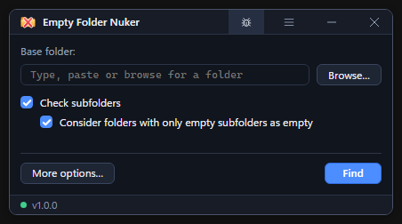
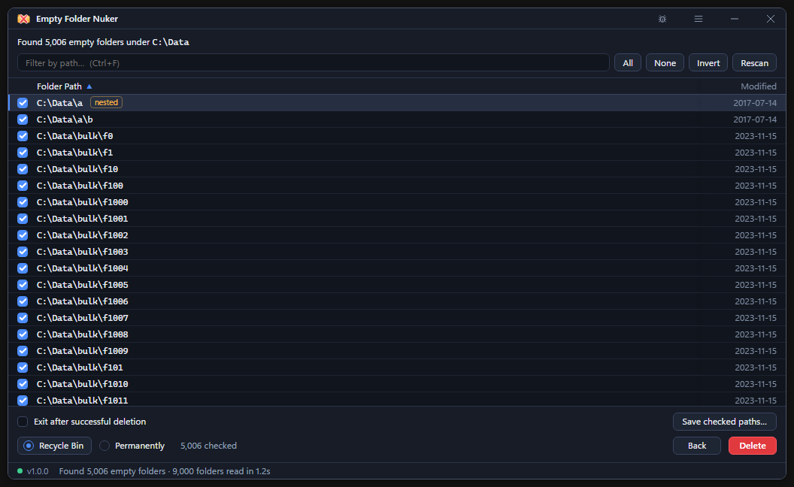

# Empty Folder Nuker

A portable Windows utility for finding and removing empty folders. It scans a folder you choose, shows what it found, and lets you decide which folders to remove.

## Screenshots





## Download

Download [EmptyFolderNuker.exe](https://github.com/AuZzii-Xssistant/EmptyFolderNuker/releases/latest/download/EmptyFolderNuker.exe) from the [latest GitHub release](https://github.com/AuZzii-Xssistant/EmptyFolderNuker/releases/latest). The release notes give the version and SHA-256.

The app runs on Windows 10 and 11 with Microsoft Edge WebView2 Runtime. Run the portable executable directly.

## Find and remove empty folders

1. Browse for a base folder, paste its path, or drag a folder onto the window.
2. Choose whether to scan subfolders and count folders containing only empty subfolders.
3. Select **Find**, then review the checked results. Use the filter to narrow a large list.
4. Choose **Recycle Bin** or **Permanently**, then confirm. The Recycle Bin is the default.

**More options** controls which folders to skip, whether known junk files count as content, and your default deletion method. The app rechecks folders before removal. It keeps folders with newly discovered content or subfolders outside the last scan. You can opt in to scanning through links, but deletion leaves linked locations alone.

Deleting a **nested** parent also removes its empty subfolders, including unchecked ones. The app warns before this happens. Only unchanged junk files found during the scan can go with their folder.

## Explorer right-click menu

Choose **Enable context menu** from the app menu. Explorer can then run **Find empty folders** on folders, drive roots, and blank areas inside folders. On Windows 11 it appears under **Show more options**.

After the window opens, the app refreshes its copy in `%LOCALAPPDATA%\EmptyFolderNuker`, even with the context menu disabled. Close the running app before opening a newer download so it can update the saved copy. The app compares versions first, then build timestamps within the same version. If the automatic refresh fails, the app menu offers a retry.

By default, Explorer scan requests reuse the existing window. To open separate windows, enable **Allow multiple instances** in Settings, then close all app windows and reopen the app.

**Disable context menu** removes the Explorer entry and keeps the saved copy. The portable executable also accepts `--scan <folder>`, `--enable-context-menu`, `--disable-context-menu`, `--help`, and `--version`.

## Build and test

GitHub Actions tests and builds the Windows executable on pull requests and on pushes to `main`. You can also run **Windows build** manually from the **Actions** tab. Download the `EmptyFolderNuker-Windows-x64` artifact from a successful run for the executable and its checksum.

To publish a GitHub Release, choose **Run workflow** on `main` and enable **Publish the verified Windows build as a GitHub Release**. The release uses the executable from that run and gets its own build tag. The **initial release** option uses the `v1.0.0` tag and the original release notes, updated to match the build.

The scanning and deletion logic lives in `core/`. The Windows app uses Tauri 2 with an embedded HTML, CSS, and JavaScript interface.

On Windows, install the Rust MSVC toolchain, Microsoft C++ build tools, Windows SDK, Node.js, and Playwright with Chromium. Run the build script from PowerShell in this directory.

```powershell
.\build.ps1
```

If Playwright is installed outside the project, set `EFN_PLAYWRIGHT` to its module directory. Set `CHROMIUM` to use an existing Chromium or Edge executable. The script runs the Rust and browser suites, builds the portable executable, and writes it with its SHA-256 to `builds/`. On Linux, `bash build.sh` uses cargo-xwin to build the Windows executable.

## Report a problem or suggest an improvement

Use the bug icon in the title bar to open [GitHub Issues](https://github.com/AuZzii-Xssistant/EmptyFolderNuker/issues/). Choose **New issue** and select a bug report or feature request. For a bug, include your Windows version, the app version from About, and steps to reproduce it. Remove private paths from anything you attach.
